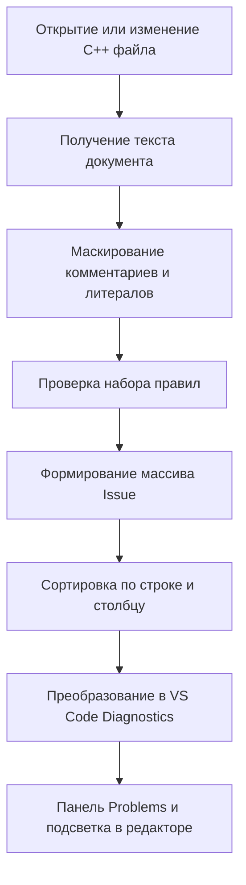

# Архитектура C++ Code Checker

## Назначение

Расширение выполняет лёгкий статический анализ открытого C/C++ документа. Оно не запускает компилятор и не изменяет исходный файл.

## Компоненты

1. **Точка входа (`activate`)** — создаёт коллекцию диагностик, регистрирует команду и подписывается на события открытия, сохранения и изменения документа.
2. **Получение настроек** — читает `checkOnChange` и `maxLineLength` из конфигурации VS Code.
3. **Предобработка (`maskNonCode`)** — заменяет содержимое комментариев и строковых/символьных литералов пробелами, сохраняя переводы строк и позиции символов. Это снижает число ложных совпадений.
4. **Анализ (`analyzeSource`)** — применяет набор правил к строкам исходного кода.
5. **Хранилище результатов** — массив `Issue` содержит строку, диапазон, уровень важности, код правила и сообщение.
6. **Сортировка** — результаты сортируются по номеру строки и столбца.
7. **Вывод** — каждый `Issue` преобразуется в `vscode.Diagnostic` и передаётся в `DiagnosticCollection`; VS Code показывает их в редакторе и панели Problems.

## Блок-схема

## Используемые структуры данных и алгоритмы

- `string[]` — строки исходного текста и посимвольная обработка при маскировании.
- `Issue[]` — хранение всех найденных замечаний.
- `Set<string>` — хранение уже встреченных заголовков для обнаружения повторных `#include` за ожидаемое O(1) на одну проверку в среднем.
- Сортировка массива диагностик — `O(k log k)`, где `k` — число найденных замечаний.
- Маскирование и построчные проверки — линейны по размеру исходного текста при фиксированном наборе правил; сортировка добавляет `O(k log k)`.

## Ограничения

Это эвристический анализатор на регулярных выражениях. Он не разбирает грамматику C++, не разрешает имена и типы и не заменяет компилятор, clang-tidy или полноценный Language Server. Отдельные правила могут давать ложные срабатывания.
